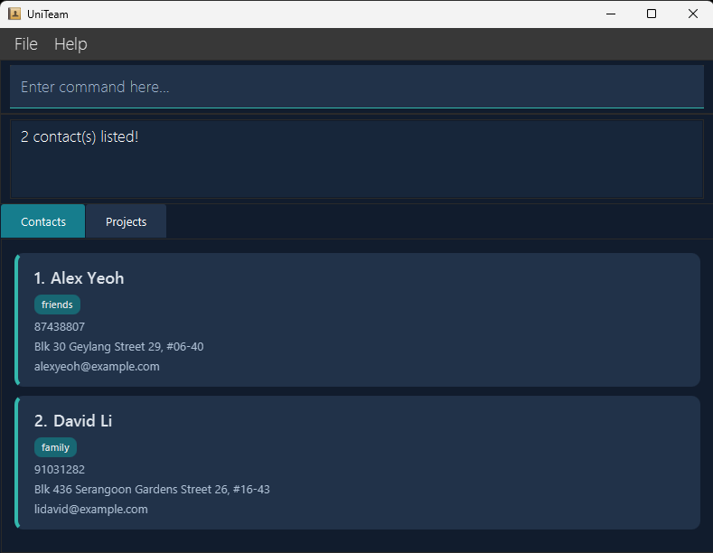

# UniTeam User Guide

UniTeam is a **desktop application for managing academic contacts and projects separate from personal phone contacts 
and organised by involvement in projects, optimised for use through a Command Line Interface (CLI)** 
while retaining the benefits of a Graphical User Interface (GUI). If you type quickly, UniTeam can help you manage 
contacts faster than traditional GUI applications.

--------------------------------------------------------------------------------------------------------------------

## Quick Start

1. Ensure that Java `25` or later is installed on your computer. 
   **Mac users:** Ensure you have the precise JDK version prescribed [here](https://se-education.org/guides/tutorials/javaInstallationMac.html).

2. Download the latest `.jar` file from [here](https://github.com/AY2627S1-CS2103T-T08-2/tp/releases).

3. Copy the file to the folder you want to use as the _home folder_ for UniTeam.

4. Open a terminal, `cd` to the folder containing the JAR file, and run `java -jar uniteam.jar`. 
   A GUI similar to the one below should appear in a few seconds. Note how the app contains some sample data. 
   

5. Type a command in the command box and press Enter to execute it. For example, type **`help`** and press Enter to open the help window. 
   Some example commands you can try:

   * `list` : Lists all contacts.

   * `add n/John Doe p/98765432 e/johnd@example.com a/John street, block 123, #01-01` : Adds a contact named `John 
   Doe` to UniTeam.

   * `delete 3` : Deletes the 3rd contact shown in the current list.

   * `clear` : Deletes all contacts, projects, associations and member roles.

   * `exit` : Exits the app.

6. Refer to the [Features](#features) section below for details of each command.

--------------------------------------------------------------------------------------------------------------------

## Features

**Notes about the command format:** 

* Words in `UPPER_CASE` are the parameters to be supplied by the user. 
  For example, in `add n/NAME`, replace `NAME` with a value such as `John Doe`.

* Items in square brackets are optional. 
  For example, `n/NAME [t/TAG]` can be used as `n/John Doe t/friend` or as `n/John Doe`.

* Items followed by `...` can appear zero or more times. 
  For example, `[t/TAG]... ` may be omitted, or written as `t/friend` or `t/friend t/family`.

* Prefixed parameters can appear in any order. 
  For example, `add n/NAME p/PHONE_NUMBER e/EMAIL a/ADDRESS` also accepts
  `add p/PHONE_NUMBER n/NAME a/ADDRESS e/EMAIL`.
  Positional parameters, such as the index in `edit INDEX`, must remain in
  the position shown in the command format.

* Enter each command on a single line. Separate prefixed arguments with spaces
  or tabs.

* Contacts and Projects have separate displayed lists and filters.
  An index refers to the number currently shown in the relevant list, not a
  permanent identifier. Check the displayed numbers after changing a filter
  or modifying a list.

* Commands that take no parameters (`help`, `list`, `exit`, and `clear`) reject extra arguments. 
  For example, `help 123` reports an invalid command format and shows the usage for `help`.
  Leading and trailing whitespace is allowed.

* If you are using a PDF version of this document, be careful when copying and pasting commands that span multiple lines as space characters surrounding line-breaks may be omitted when copied over to the application.

### Viewing help: `help`

Shows a message explaining how to access the help page.

Format: `help`

### Adding a contact: `add`

Adds a contact to UniTeam.

Format: `add n/NAME p/PHONE e/EMAIL a/ADDRESS [t/TAG]... `

**Field restrictions**

Leading and trailing spaces and tabs are removed from field values.

| Field          | Restrictions                                                                                | Example                             |
|----------------|---------------------------------------------------------------------------------------------|-------------------------------------|
| `NAME`         | Must not be blank. Contains only English letters (`A–Z`, `a–z`), digits (`0–9`) and spaces. | `Alex Tan`                          |
| `PHONE`         | Display text; must not be blank or contain control characters. Spaces, punctuation and labels are allowed. | `+65 9123 4567 (HP)`                |
| `EMAIL`        | Must follow the `local-part@domain` format and the rules below.                             | `alex.tan@example.com`              |
| `ADDRESS`      | Must not be blank. Spaces and punctuation are allowed.                                      | `Block 123, Clementi Ave 2, #01-01` |
| `TAG`          | Contains one or more English letters or digits, without spaces or punctuation.              | `projectTeam`                       |

**Email rules:**

* The local part contains English letters and digits, optionally separated
  by single `+`, `_`, `.` or `-` characters.
* The local part must start and end with a letter or digit. Consecutive
  special characters are rejected.
* The domain consists of labels separated by dots. Each label contains
  English letters and digits, optionally separated by single hyphens.
* Each domain label must start and end with a letter or digit, and the
  final label must contain at least 2 characters.

The `n/`, `p/`, `e/` and `a/` prefixes are required and must each appear
exactly once. The optional `t/` prefix may appear multiple times to add
multiple tags. Each supplied tag must have a non-empty value.

Invalid field values or repeated single-valued prefixes produce an error
without adding the contact.

Contacts can share a name. A contact is rejected as a duplicate only when its name, phone number, email, address,
and tags all match an existing contact, including contacts hidden by the current filter. Tag order does not matter.
A difference in any of these fields allows a separate contact, even if only the address or tags differ.

**Tip:** A contact can have any number of tags, including zero.

Examples:
* `add n/John Doe p/98765432 e/johnd@example.com a/John street, block 123, #01-01`
* `add n/Betsy Crowe t/friend e/betsycrowe@example.com a/Newgate Prison p/1234567 t/criminal`

The phone field is stored and compared as one display string; UniTeam does not parse numbers or labels from it. It can contain multiple numbers and labels, such as `1234 5678 (HP) 1111-3333 (Office)`. Both commands below succeed because the contacts have different phone display text:

* `add n/Alex Tan p/91234567 e/alex@example.com a/Block 1`
* `add n/Alex Tan p/98765432 e/alex@example.com a/Block 1`

Repeating either command is rejected with `This contact already exists in UniTeam.`

### Listing all contacts: `list`

Shows a list of all contacts in UniTeam.

Format: `list`

### Locating contacts by name: `find`

Finds contacts whose names contain any of the given keywords.

Format: `find KEYWORD [MORE_KEYWORDS]`

* The search is case-insensitive; for example, `hans` matches `Hans`.
* Keyword order does not matter; for example, `Hans Bo` matches `Bo Hans`.
* The search considers only names.
* Only full words match; for example, `Han` does not match `Hans`.
* Contacts matching at least one keyword are returned (an `OR` search); for example, `Hans Bo` returns `Hans Gruber`
  and `Bo Yang`.

Examples:
* `find John` returns `john` and `John Doe`
* `find alex david` returns `Alex Yeoh`, `David Li` 
  

### Editing a contact: `edit`

Edits an existing contact in UniTeam.

Format: `edit INDEX [n/NAME] [p/PHONE] [e/EMAIL] [a/ADDRESS] [t/TAG]... `

* Edits the contact at the specified `INDEX`. The index refers to the index number shown in the displayed contact list.
  The index **must be a positive integer** 1, 2, 3, ...
* At least one of the optional fields must be provided.
* Existing values will be updated to the input values.
* When editing tags, all of the contact's existing tags are removed; adding tags is not cumulative.
* To remove all of a contact's tags, enter `t/` without a tag after it.
* A contact can be renamed to share another contact's name, provided their complete details differ.
  An edit that makes all five fields match another contact is rejected with
  `This contact already exists in UniTeam.`, including when the other contact is hidden by a filter.
  The rejected edit leaves the contacts unchanged.
* Providing an existing field value without changing the contact's details is allowed.
* Edited values follow the same
  [field restrictions as adding a contact](#adding-a-contact-add).
  Each of `n/`, `p/`, `e/` and `a/` may appear at most once.
  The `t/` prefix may appear multiple times; a single empty `t/` clears all tags.

Examples:
*  `edit 1 p/91234567 e/johndoe@example.com` Edits the phone number and email address of the 1st contact to be
   `91234567`
   and `johndoe@example.com` respectively.
*  `edit 2 n/Betsy Crower t/` Edits the name of the 2nd contact to be `Betsy Crower` and clears all existing tags.

### Deleting a contact: `delete`

Deletes the specified contact from UniTeam.

Format: `delete INDEX`

* Deletes the contact at the specified `INDEX`.
* The index refers to the index number shown in the displayed contact list.
* The index **must be a positive integer** 1, 2, 3, ...
* Deleting a contact also removes all of that contact's project associations
  and member roles. The projects themselves remain in UniTeam.

Examples:
* `list` followed by `delete 2` deletes the 2nd contact in UniTeam .
* `find Betsy` followed by `delete 1` deletes the 1st contact in the results of the `find` command.

### Adding a project: `addproject`

Adds a project to UniTeam.

Format: `addproject n/PROJECT_NAME d/YYYY-MM-DD [desc/DESCRIPTION]`

* `PROJECT_NAME` must contain 1–50 characters after whitespace normalisation.
  It must contain at least one letter or digit, and may contain letters, digits,
  spaces, hyphens, apostrophes, ampersands and parentheses.
* Leading and trailing whitespace is removed, and repeated whitespace is
  replaced with a single space.
* Project names must be unique after case and whitespace normalisation.
* The deadline must be a valid calendar date in `YYYY-MM-DD` format.
  Past dates are allowed.
* `DESCRIPTION` is optional and may contain up to 200 characters without line
  breaks. If `desc/` is supplied, its value must not be blank.
* Adding a project clears the current project search, so the Projects list
  shows all projects. The contact filter is unchanged.
* Each prefix may appear at most once. Invalid input or a duplicate project
  name produces an error without adding a project.

Examples:

* `addproject n/CS2103T Team Project d/2026-11-13`
* `addproject n/Orbital d/2027-08-01 desc/Build a project planning application`

### Listing projects: `listprojects`

Lists projects in the order they were added, including each project's deadline and description.

Format: `listprojects [c/CONTACT_INDEX]`

* Without `c/`, lists all projects. If no projects exist, UniTeam reports that there are no projects to list.
* With `c/`, lists only projects associated with the selected contact and identifies the contact in the result.
  `CONTACT_INDEX` must be a positive integer referring to the currently displayed Contacts list, including after `find`.
* Project numbers match the currently displayed Projects list, so they remain valid for `associate` and `dissociate`.
  Associated projects hidden by a project search are still listed in the feedback, marked `[not displayed]` without
  a number. Use `listprojects` to restore all projects before selecting a hidden project by index.
* A contact with no associated projects produces an informational message.
* Missing or invalid contact indices, out-of-range indices, duplicate `c/` prefixes, and unsupported arguments are rejected.
* Contact-specific results appear in the command feedback area. The selected tab and both list filters remain
  unchanged. Contacts, projects, and their associations are also unchanged.

Examples:

* `listprojects` lists all projects.
* `listprojects c/2` lists projects associated with the second currently displayed contact.
* `find Alex` followed by `listprojects c/1` lists projects for the first contact in the search results.

### Locating projects by name: `findproject`

Finds projects whose names contain any of the supplied keywords and opens
the Projects tab.

Format: `findproject KEYWORD [MORE_KEYWORDS]...`

* At least one keyword is required.
* Searching is case-insensitive and considers project names only.
* Keywords match whole words separated by whitespace.
  For example, `Team` matches `Team Project`, but `Tea` does not.
* A project is returned when its name matches at least one keyword.
* Keyword order does not matter.
* Results retain their original list order and are numbered starting from 1.
* Project-index commands use these displayed numbers.
* The contact filter is unchanged.
* If nothing matches, the Projects list is empty. Use `listprojects` to show
  all projects again.

Examples:

* `findproject CS2103T` finds projects containing the word `CS2103T`.
* `findproject Team Orbital` finds projects containing either `Team` or `Orbital`.
* `listprojects` restores the complete Projects list after a search.

### Editing a project: `editproject`

Edits the details of a project identified by its displayed index.

Format: `editproject INDEX [n/PROJECT_NAME] [d/YYYY-MM-DD] [desc/DESCRIPTION]`

* `INDEX` must be a positive integer referring to the currently displayed
  Projects list, including results from `findproject`.
* At least one field must be supplied. Omitted fields retain their values.
* The name, deadline and description follow the same constraints as
  `addproject`.
* Enter `desc/` without a value to clear the description.
* A project cannot be renamed to another project's name, including a project
  hidden by the current search.
* Editing a project preserves its contact associations and member roles.
* A successful edit clears the project search and shows all projects.
  The contact filter is unchanged.
* Providing an existing value without changing the project's details is allowed.

Examples:

* `editproject 1 d/2026-12-01` changes the first displayed project's deadline.
* `editproject 2 n/Updated Project desc/` renames the second displayed project
  and clears its description.
* `findproject Orbital` followed by `editproject 1 desc/Build a mobile application`
  edits the first project in those search results.

### Deleting a project: `deleteproject`

Deletes a project identified by its displayed index.

Format: `deleteproject INDEX`

* `INDEX` must be a positive integer referring to the currently displayed
  Projects list, including results from `findproject`.
* Deleting a project also removes its contact associations and member roles.
  The contacts themselves remain in UniTeam.
* Other projects and their associations are unchanged.
* The current project search remains active after deletion.
* If the Contacts list was showing members of the deleted project, that list
  becomes empty. Use `list` to show all contacts again.
* This action cannot be undone within UniTeam.

Examples:

* `listprojects` followed by `deleteproject 2` deletes the second displayed project.
* `findproject Orbital` followed by `deleteproject 1` deletes the first project
  in those search results.

### Associating a contact with a project: `associate`

Records that a contact is involved in an existing project.

Format: `associate c/CONTACT_INDEX pr/PROJECT_INDEX`

* `CONTACT_INDEX` refers to the numbered contact in the Contacts tab, including results from `find`.
* `PROJECT_INDEX` refers to the numbered project in the Projects tab, not the UUID shown beside `ID:`.
* Both indices must be positive integers. Each prefix must appear exactly once; their order does not matter.
* An existing contact-project pair cannot be associated again. A contact can belong to multiple projects, and a
  project can involve multiple contacts.
* The success message identifies the contact and project. Invalid syntax, out-of-range indices, and duplicate
  associations produce an error and leave existing associations unchanged.

Projects are numbered starting from 1 in the currently displayed Projects list.
After `findproject`, these numbers refer to the search results. Use `listprojects`
to restore all projects before selecting a project hidden by the search.
Switching tabs does not change either list's indices or reset its filter.

Example, with at least two contacts and no existing projects:

1. `list` shows all contacts in the Contacts tab; note the second contact's name.
2. `addproject n/CS2103T Team Project d/2026-11-13` creates project 1.
3. Open the Projects tab and confirm that `CS2103T Team Project` is numbered 1.
4. `associate c/2 pr/1` associates the second contact in the Contacts tab with that project.

After `find Betsy`, use `associate c/1 pr/1` to associate the first search result with project 1 instead.

### Listing project members: `listmembers`

Lists the contacts associated with a project, in address-book order.
The Contacts tab shows their contact cards. The command feedback lists their names and any assigned member roles.

Format: `listmembers pr/PROJECT_NAME`

Example, with at least one contact and no existing projects:

1. Run `list` to display all contacts.
2. Create a project with `addproject n/CS2103T Team Project d/2026-11-13`.
   Since no projects existed beforehand, the new project is numbered 1.
3. Run `associate c/1 pr/1` to associate the first displayed contact with it.
4. Run `listmembers pr/CS2103T Team Project` to see the associated contact
   as a card in the Contacts tab.

UniTeam automatically opens the Contacts tab and shows only members of the named project, including their phone,
email, address and tags. Index-based commands use the numbers on these displayed cards.
Use `list` to restore all contacts, or `find KEYWORD` to replace the member filter with a name search.
Use `listprojects` to switch to the Projects tab.

If the project exists but has no associated contacts, UniTeam reports that no contacts are associated with it
and displays an empty contact list.
If no project has the specified name, UniTeam reports that the project does not exist. Project names are matched
without regard to letter case and with whitespace normalised.

### Setting or clearing a project member's role: `setrole`

Sets or clears a contact's role in a project. Roles belong to a contact-project association,
so the same contact can have different roles in different projects.

Format: `setrole c/CONTACT_INDEX pr/PROJECT_INDEX r/[ROLE]`

* `CONTACT_INDEX` refers to the currently displayed Contacts list, including
  results from `find` or `listmembers`.
* `PROJECT_INDEX` refers to the currently displayed Projects list, including
  results from `findproject`.
* Both indices must be positive integers.
* The contact must already be associated with the selected project.
* The `c/`, `pr/` and `r/` prefixes are all required and must each appear once.
  Their order does not matter.
* A role may contain up to 200 characters and must not contain line breaks.
  Surrounding whitespace is removed.
* Leave the value after `r/` empty to clear the role while retaining the
  contact-project association.
* Setting an unchanged role or clearing an already empty role is allowed.
* Both list filters remain unchanged.
* Roles are saved and remain available after restarting UniTeam.

Examples:

* `setrole c/2 pr/1 r/Implement the parser` assigns that role to displayed
  contact 2 in displayed project 1.
* `setrole c/2 pr/1 r/` clears that member's role without removing the association.

Run `listmembers pr/PROJECT_NAME` to see member roles in the command feedback.
The contact cards display contact details.

### Dissociating a contact from a project: `dissociate`

Removes an existing association between a contact and a project while retaining their information.

Format: `dissociate c/CONTACT_INDEX pr/PROJECT_INDEX`

* `CONTACT_INDEX` refers to the numbered contact in the Contacts tab, including results from `find`.
* `PROJECT_INDEX` refers to the numbered project in the Projects tab, not the UUID shown beside `ID:`.
* Both indices must be positive integers. Each prefix must appear exactly once; their order does not matter.
* Only the selected association is removed. The contact, project, and all other associations remain unchanged.
* The success message identifies the contact and project. Invalid syntax, out-of-range indices, and a pair with no
  existing association produce an error without changing the data.
* Successful removal is saved automatically and remains in effect after restarting UniTeam.

Switching tabs does not change either list's indices or reset the contact search results.

Example, with at least two displayed contacts and project 1 named `CS2103T Team Project`:

1. `associate c/2 pr/1` creates the association if it does not already exist.
2. `dissociate c/2 pr/1` removes that association while retaining the contact and project.
3. `listmembers pr/CS2103T Team Project` confirms that the contact is no longer a member; other members remain.

After `find Betsy`, use `dissociate c/1 pr/1` to remove the first search result's association with project 1.
Repeating dissociation for the same pair reports that the contact is not associated with the project.

### Clearing all entries: `clear`

Clears all contacts, projects and associations from UniTeam.

Format: `clear`

### Exiting the program: `exit`

Exits the program.

Format: `exit`

### Saving the data

UniTeam automatically saves contacts, projects, associations and member roles
after every successful command. No separate save command is needed.

The data file is `data/addressbook.json`, relative to the folder from which
you launch UniTeam. Following the Quick start instructions places this file
inside the folder containing your JAR.

If a command changes stored data but saving fails, UniTeam restores the previous
data and list filters, and reports that the command was not applied.
Resolve the reported save problem before retrying.

Commands that do not change stored data, such as `help`, `list` and `exit`,
can still complete when saving fails. Their feedback includes a warning.

If the data file could not be loaded at startup, saving remains disabled for
that session. See the recovery instructions under
[Editing the data file](#editing-the-data-file).

### Editing the data file

UniTeam stores its data in `data/addressbook.json`, relative to the folder
from which you launch the application. Close UniTeam and back up this file
before editing it. Save the file as valid UTF-8 JSON and preserve the identifiers
and references connecting contacts, projects and associations.

**Caution:**
If your changes make the data file invalid, UniTeam starts with an empty address book at the next run. A startup error 
dialog shows the absolute path of the affected file and recovery instructions. Saving is disabled for that session to preserve the original file, and the status bar keeps a saving-disabled warning visible. Successful commands also display a warning, and changes made in that session are lost when the application closes. Close the application, copy the original file somewhere safe, then repair it or restore a valid backup and restart to resume saving. We recommend backing up the file before editing it. 
An existing file that cannot be read also triggers loading-error handling. Only a file confirmed to be missing follows the normal first-launch behavior. 
To intentionally start fresh, close the application and move the original data file somewhere safe. Restart the application; it will follow the normal first-launch behavior and populate sample contacts. 
Furthermore, certain edits can cause UniTeam to behave in unexpected ways (e.g., if a value entered is outside of the 
acceptable range). Therefore, edit the data file only if you are confident that you can update it correctly.

--------------------------------------------------------------------------------------------------------------------

## FAQ

**Q**: How do I transfer my data to another computer? 
**A**: Follow these steps:

1. Set up UniTeam on the destination computer using the
   [Quick Start](#quick-start) instructions.
2. Close UniTeam on **both computers** before copying any data.
3. Back up any existing `data/addressbook.json` in the destination
   UniTeam home folder.
4. Copy the entire `data/addressbook.json` file from the original
   UniTeam home folder to the same relative location in the destination
   home folder, replacing the destination file. Create the `data`
   folder if it does not exist.
5. Open a terminal in the destination UniTeam home folder and run
   `java -jar uniteam.jar`. Your transferred contacts, projects,
   associations and member roles should appear.

Keep UniTeam closed throughout the file transfer. Replacing its data file
while it is running can cause the next successful command to overwrite
the transferred file with the data already loaded in memory.

**Q**: Why does a second copy of UniTeam close immediately? 
**A**: Only one UniTeam instance can use the same data folder at a time.
Use the existing instance, or close it before launching another.
The terminal and log report `UniTeam is already running in this folder.`

--------------------------------------------------------------------------------------------------------------------

## Known Issues

1. **When using multiple screens**, if you move the application to a secondary screen, and later switch to using only the primary screen, the GUI will open off-screen. The remedy is to delete the `preferences.json` file created by the application before running the application again.
2. **If you minimize the Help Window** and then run the `help` command (or use the `Help` menu, or the keyboard shortcut `F1`) again, the original Help Window will remain minimized, and no new Help Window will appear. The remedy is to manually restore the minimized Help Window.

--------------------------------------------------------------------------------------------------------------------

## Command Summary

| Action                       | Format and examples                                                                                                                        |
|------------------------------|--------------------------------------------------------------------------------------------------------------------------------------------|
| **Add contact**              | `add n/NAME p/PHONE_NUMBER e/EMAIL a/ADDRESS [t/TAG]...` Example: `add n/James Ho p/22224444 e/jamesho@example.com a/Clementi t/friend` |
| **Add project**              | `addproject n/PROJECT_NAME d/YYYY-MM-DD [desc/DESCRIPTION]` Example: `addproject n/Orbital d/2027-08-01`                                |
| **Associate**                | `associate c/CONTACT_INDEX pr/PROJECT_INDEX` Example: `associate c/2 pr/1`                                                              |
| **Clear all entries**        | `clear`                                                                                                                                    |
| **Delete contact**           | `delete INDEX` Example: `delete 3`                                                                                                      |
| **Delete project**           | `deleteproject INDEX` Example: `deleteproject 2`                                                                                        |
| **Dissociate**               | `dissociate c/CONTACT_INDEX pr/PROJECT_INDEX` Example: `dissociate c/2 pr/1`                                                            |
| **Edit contact**             | `edit INDEX [n/NAME] [p/PHONE_NUMBER] [e/EMAIL] [a/ADDRESS] [t/TAG]...` Example: `edit 2 n/James Lee`                                   |
| **Edit project**             | `editproject INDEX [n/PROJECT_NAME] [d/YYYY-MM-DD] [desc/DESCRIPTION]` Example: `editproject 1 d/2026-12-01`                            |
| **Exit**                     | `exit`                                                                                                                                     |
| **Find contacts**            | `find KEYWORD [MORE_KEYWORDS]...` Example: `find James Jake`                                                                            |
| **Find projects**            | `findproject KEYWORD [MORE_KEYWORDS]...` Example: `findproject CS2103T Orbital`                                                         |
| **Help**                     | `help`                                                                                                                                     |
| **List contacts**            | `list`                                                                                                                                     |
| **List projects**            | `listprojects [c/CONTACT_INDEX]` Example: `listprojects c/2`                                                                            |
| **List members**             | `listmembers pr/PROJECT_NAME` Example: `listmembers pr/CS2103T Team Project`                                                            |
| **Set or clear member role** | `setrole c/CONTACT_INDEX pr/PROJECT_INDEX r/[ROLE]` Set: `setrole c/2 pr/1 r/Implement the parser` Clear: `setrole c/2 pr/1 r/`      |
